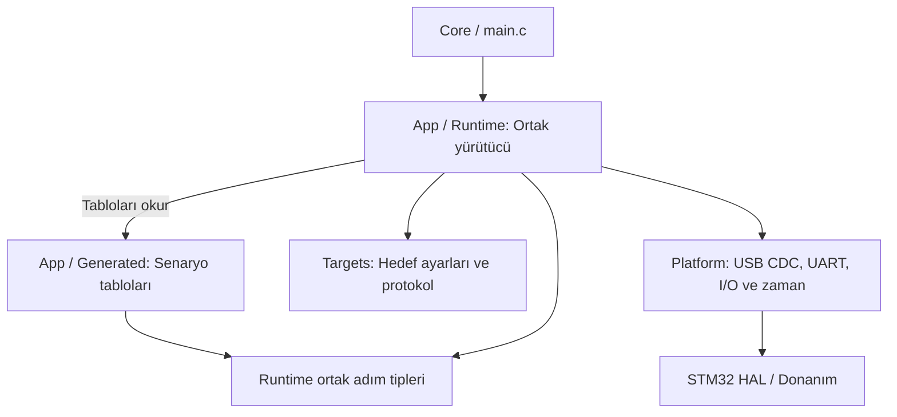

# STM32 firmware — Katman ayrımı

## Kapsam ve mevcut durum

Bu doküman STM32F407 Discovery üzerindeki firmware'i kapsar. `App`, `Targets`
ve `Platform` aynı `hilSoftware` projesinin parçalarıdır; ayrı işlemcilerde
veya ayrı firmware görüntülerinde çalışmazlar.

Şu anda katman klasörleri ve sorumlulukları tanımlıdır. `Platform` içinde
bloklamayan USB CDC arayüzü uygulanmıştır. `Core/main.c` ana döngüsündeki
ham echo, PC–Discovery bağlantısını doğrulayan geçici başlangıç uygulamasıdır;
senaryo tablosu veya runtime değildir. UART sürücüsü ve handshake senaryosu
henüz uygulanmamıştır. CubeMX başlangıcı `Core`, `Drivers`, `USB_DEVICE` ve
`Middlewares` altındadır. Aşağıdaki şablon ve yürütücü
tasarımı kararlaştırılmıştır; şablonlar, generator ve runtime henüz uygulanmamıştır.

## Dizin yapısı

Aşağıdaki yapı tasarlanan yerleşimi gösterir. `templates`, `App/Generated`
ve `App/Runtime` dizinleri uygulama adımında oluşturulacaktır.

```text
mini-Hil/
├── templates/
│   ├── scenario.c.in       Senaryo C kaynağı şablonu
│   └── scenario.h.in       Senaryo header şablonu
└── firmware/stm32f407_discovery/
    ├── hilSoftware.ioc
    ├── Core/              CubeMX başlangıç, clock, kesme ve main kodu
    ├── Drivers/           ST HAL ve CMSIS
    ├── App/
    │   ├── Generated/     Üretilen senaryo tabloları ve sabit veriler
    │   └── Runtime/       Ortak yürütücü ve adım tipleri
    ├── Targets/           Test edilen kartların tanımları ve protokolleri
    └── Platform/          Discovery donanım erişimi
```

## Karar: Şablonlardan senaryo tablosu üretimi

30 Ekim 2026 tarihinde, test senaryolarının PC'deki bir araçta hazırlanması ve
sabit C/H şablonları üzerinden üretilmesi kararlaştırılmıştır. Üretilen senaryo
tabloları, STM32 üzerinde ortak bir yürütücü tarafından çalıştırılacaktır.

- **App/Generated:** Generator tarafından oluşturulan `.c/.h` dosyalarıdır.
  `.c` dosyaları `const` adım tablolarını, parametreleri ve beklenen verileri;
  `.h` dosyaları dışarıya sunulan senaryo bildirimlerini içerir.
- **App/Runtime:** Elle geliştirilen ortak adım tiplerini ve yürütücüyü içerir.
  Adımları sırayla işler, ilerlemeyi ve süreleri takip eder, beklentileri
  değerlendirir ve test sonucunu belirler.
- **templates:** Dosya biçiminin sabit iskeletini tutar. `.in` uzantılı şablonlar
  doğrudan derlenmez; generator bunlardan gerçek `.c/.h` kaynaklarını üretir.

Generator her senaryo için ayrı C durum makinesi üretmeyecektir. Çalışma
akışını ortak runtime yönetir; senaryoların adım sayısı, sırası, işlem türleri,
verileri ve süreleri üretilen tabloda tanımlanır. Ortak runtime'ın kendi durum
makinesi bulunabilir. Desteklenen işlemlerle yeni senaryo oluşturmak runtime
değişikliği gerektirmez; yeni bir işlem yeteneği gerektiğinde runtime ve
generator doğrulaması birlikte geliştirilir.

Senaryo tanımı, generator ve şablonlar üretimin kaynaklarıdır. Üretilen
dosyalara elle müdahale edilmez. Senaryo değişiklikleri kaynak tanımında,
dosya biçimi değişiklikleri şablonda, yürütme davranışı değişiklikleri runtime'da
yapılır. Ortak tipler şablonlara kopyalanmaz; runtime'ın ortak header'ından alınır.
`Targets` ve `Platform` elle geliştirilen katmanlar olarak kalır.

### Üretim ve çalıştırma akışı

```text
PC aracında senaryo tanımı
        ↓
Generator + scenario.c.in / scenario.h.in
        ↓
App/Generated/*.c ve *.h
        ↓
Runtime + Targets + Platform ile birlikte derleme
        ↓
STM32'ye yükleme ve testin STM32 üzerinde yürütülmesi
```

Bu modelde senaryo değişikliği yeniden üretim, derleme ve karta yükleme
gerektirir. PC aracının ve GUI'nin uygulanması mevcut STM32 geliştirme adımının
dışındadır; firmware tarafındaki senaryo sözleşmesi bu üretim modeline göre
tasarlanacaktır.

### Üretim kuralları ve doğrulama

- Generator; desteklenmeyen işlemleri, hatalı parametreleri ve doldurulmamış
  şablon alanlarını hata olarak bildirmelidir. Hatalı çıktı derlemeye sunulmamalıdır.
- Aynı senaryo, şablon ve generator sürümü aynı kaynak çıktısını üretmelidir.
- Adım ve veri boyutları, runtime kapasitesine göre sınırlanmalıdır. Bekleme
  adımlarının tamamlanma ve timeout davranışı açıkça tanımlanmalıdır.
- Sabit tablolar `const` tanımlanmalı; Flash yerleşimi uygulama sırasında
  linker/map çıktısıyla doğrulanmalıdır. Değişken yürütme durumu runtime'da tutulur.
- Senaryo, generator, şablon ve firmware sürümleri test sonucuyla ilişkilendirilmelidir.
- Generator çıktısının bilinen örneklerle kontrolü ve runtime davranış testleri
  ayrı yapılmalıdır. Başarılı derleme, senaryo beklentilerinin doğruluğunu veya
  ECU davranışını tek başına kanıtlamaz.

## Bağımlılık yönü



Oklar kod bağımlılığını gösterir. `App/Runtime`, üretilen senaryo verisini,
hedef protokolünü ve donanım erişimini kullanarak testi yürütür. Üretilen
senaryolar ortak adım tiplerine bağımlıdır; HAL veya hedef sürücüsü çağırmaz.
`Targets` ile `Platform` doğrudan birbirini çağırmaz; aralarındaki mesaj/veri
akışını `App/Runtime` yönetir.

## Sorumluluk sınırları

| Katman | İçerir | Diğer katmanlara bırakır |
| --- | --- | --- |
| App/Generated | Senaryo adımları, parametreler ve beklenen davranışın sabit veri olarak tanımı | Adımların yürütülmesi ve donanım çağrıları |
| App/Runtime | Ortak adım tipleri, yürütme durumu, süre sınırlarının değerlendirilmesi, PASS/FAIL kararı | Baytların paketlenmesi ve fiziksel aktarılması |
| Targets | Hedef kimliği, haberleşme ayarları, mesaj oluşturma, paket ayrıştırma ve protokol geçerliliği | UART sürücüsü ve senaryonun PASS/FAIL kararı |
| Platform | USB CDC/UART/I/O erişimi, aktarım tamponları, zaman okuma ve donanım hataları | Hedef mesajlarının anlamı ve test beklentileri |

`App` ve `Targets` doğrudan HAL veya register erişimi içermemelidir. HAL
bağımlılığı `Platform` ve CubeMX'in ürettiği `Core` kodunda tutulmalıdır.

Discovery'nin pinmux ve çevre birimi başlangıcı `.ioc`/`Core` yapılandırmasına
aittir. HIL kanallarının hedef konnektöründeki karşılıkları hedef bağlantı
tanımına aittir. Hedef profili, donanımın desteklemediği bir pin eşlemesini
yalnızca ayar değiştirerek uygulanabilir hale getirmez.

## Başlangıç doğrulaması: PC–Discovery USB CDC

PC, USB Host; Discovery, USB Device / CDC-ACM olarak çalışır. MCU'nun CN5
bağlantısı kullanılır. Platform bayt taşır; mevcut ana döngü bunları aynen
geri gönderir. ST CDC callback'leri yalnızca aktarım verisini ve durumunu
Platform'a bildirir. Ayrıntılar: [USB CDC doğrulama](USB_CDC_DOGRULAMA.md).

Bu bağlantı ileride PC komutları ve sonuç aktarımı için kullanılabilir.
Komut protokolü henüz tanımlanmamıştır. Senaryonun şablondan üretilip STM32
üzerinde yürütülmesi kararı korunur; canlı PC senaryo yorumlayıcısı eklenmez.

## İlk hedef testi: UART handshake

1. `App/Runtime`, `App/Generated` tablosundaki handshake adımını başlatır.
2. `Targets`, hedef protokolüne uygun istek paketini oluşturur.
3. `App/Runtime`, bu paketin gönderilmesini `Platform` üzerinden ister.
4. `Platform`, aktarımı gerçekleştirir ve gelen baytları sağlar.
5. `Targets`, gelen veriyi ayrıştırıp protokol sonucunu bildirir.
6. `App/Runtime`, yanıtın tablodaki beklentiyi ve süre sınırını karşılayıp
   karşılamadığına göre test sonucunu belirler.

Geçerli bir paket, başarılı test ile aynı şey değildir. Örneğin protokole
uygun bir olumsuz yanıt doğru ayrıştırılabilir; senaryonun beklediği davranışa
göre test başarısız olabilir.

Çalışma akışı bloklamayan bir ana döngü üzerine kurulacaktır. Kesme tarafında
aktarım için gerekli kısa işlemler ve durum bildirimi yapılacak; senaryo
kararları ana döngüde verilecektir. Tampon sınırları ve taşma davranışı UART
arayüzü tasarlanırken açıkça tanımlanacaktır.

## Hedef değişikliği

Yeni hedefin ayarları ve protokolü `Targets` altında tanımlanır. Beklenen
davranış veya test adımları değişirse kaynak senaryo tanımı değiştirilir ve
`App/Generated` yeniden üretilir. Mevcut işlem türleri yeterliyse `App/Runtime`,
aynı HIL donanım yetenekleri kullanılıyorsa `Platform` korunur.

İlk aşamada tek hedefin derleme sırasında seçilmesi önerilir. Çalışma sırasında
profil yükleme ve eklenti sistemi bu adımda kurulmaz. İlk runtime yalnızca
ilk senaryonun gerektirdiği, tanımlanmış işlem türlerini destekleyecektir.

## Sonraki uygulama adımı

Önce USB CDC echo gerçek PC–Discovery bağlantısında doğrulanacaktır. Ardından
ortak test adımının C veri yapısı, senaryo bildirim arayüzü ve runtime'ın
destekleyeceği ilk işlemler tanımlanacaktır. `scenario.c.in` ve `scenario.h.in`
şablonları bu sözleşme üzerine kurulacaktır. Kaynak senaryo dosyasının biçimi
ve şablon alanlarının sözdizimi henüz kararlaştırılmamıştır.

İlk hedefin UART bağlantısı, mesaj sözleşmesi, süre ölçüm noktaları ve yanıt
beklentisi de netleştirilmelidir. ECU uygulaması ve PC senaryo aracı/GUI bu
STM32 geliştirme kapsamına dahil değildir; küçük USB doğrulama betiği bu
sınırın dışındaki ayrı bir kontrol aracıdır.
